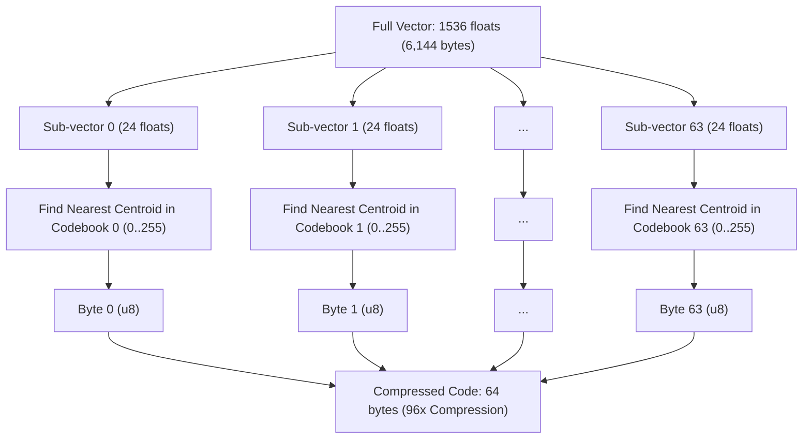
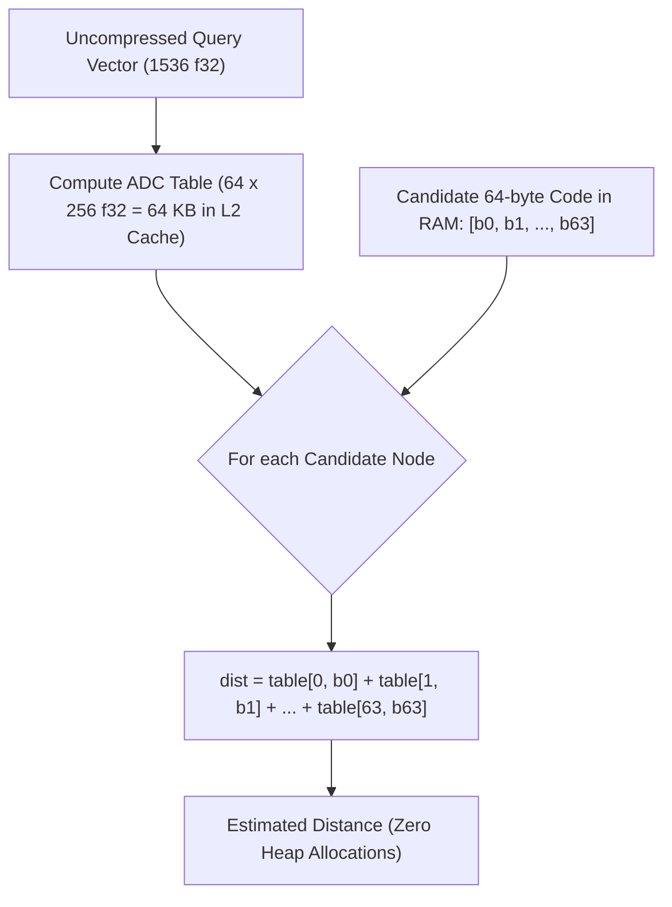

# LightVector — Task 02 Implementation & Architecture Report

## Executive Summary

**Task 02: Product Quantization (PQ) Compression Module** has been successfully designed, implemented, tested, and verified.

In disk-native vector search systems, keeping millions of uncompressed floating-point vectors in RAM is prohibitively expensive (e.g., 100,000 vectors at 1536 dimensions require $>600\text{ MB}$ of memory, and 10 million vectors require $>60\text{ GB}$). 

**Task 02 solves this problem** by introducing an in-RAM vector compressor that uses $k$-means clustering to compress 1536-dimensional `f32` vectors ($6,144$ bytes each) down to just **64 to 128 bytes** (a **$16\times$ to $96\times$ compression ratio**). During nearest neighbor search, an **Asymmetric Distance Computation (ADC)** lookup table allows candidates to be evaluated entirely in RAM with **zero heap allocations**, before issuing high-speed NVMe disk reads for exact re-ranking.

---

## 1. What Was Implemented

### 1. Subspace $k$-Means Clustering Engine (`src/quantization/kmeans.rs`)
- **Lloyd's Algorithm**: Clusters $d_{sub}$-dimensional sub-vectors into $k=256$ centroids.
- **Seeded Deterministic Initialization**: Supports reproducible training and testing with PRNG seeds.
- **Empty Cluster Recovery**: Detects unassigned centroids and dynamically re-seeds them from training samples.
- **Early Convergence**: Tracks maximum centroid shift ($\max \|\Delta c\| < 10^{-4}$) to terminate training early once stable.

### 2. Product Quantizer (`src/quantization/mod.rs`)
- **`ProductQuantizer`**:
  - **Multi-Subspace Parallel Training**: Uses `rayon` to train all $M$ subspaces concurrently across available CPU cores.
  - **Vector Encoding**: Converts any $D$-dimensional float vector into an $M$-byte compact code (`Vec<u8>`).
  - **Vector Decoding**: Reconstructs an approximate full-precision vector from an $M$-byte code by looking up centroid coordinates.
  - **Zero-Allocation APIs**: Provides in-place buffer APIs (`encode_into`, `decode_into`, `compute_adc_table_into`) to avoid allocations on hot execution paths.

### 3. Asymmetric Distance Computation (`AdcTable`)
- **Precomputed Distance Matrix**: Computes squared distances between an uncompressed query vector and all $M \times 256$ centroids into an in-RAM table ($M \times 256 \times 4$ bytes, typically only 64 KB).
- **Zero Heap Allocations During Search**: `AdcTable::compute_distance` and `AdcTable::compute_distance_squared` perform pure direct array lookups using pointer math (`table[m * 256 + code[m]]`), keeping query evaluation completely in L1/L2 cache with zero memory allocations.

### 4. Validation & Error Handling (`QuantizationError`)
- Validates that dimensions are divisible ($D \pmod M = 0$).
- Validates codebook sizes and training dataset minimums ($N \ge 256$).
- Validates vector lengths and buffer capacities with descriptive error variants.

---

## 2. Working Architecture (In Simple Terms)

### A. How Vector Compression Works (Encoding)

### B. Asymmetric Distance Computation (ADC) During Search

Instead of decompressing database vectors or reading uncompressed vectors from SSD during initial graph traversal, search is performed entirely in RAM using precomputed lookup tables:

1. **Query Arrives**: The query vector is compared against the $M \times 256$ centroids once to produce the `AdcTable`.
2. **Graph Traversal**: For every candidate node visited in RAM, computing its distance requires only $M$ array lookups and additions.
3. **Re-Ranking**: Top candidates identified via PQ are then fetched from NVMe disk in full precision for final ranking.

---

## 3. Verification & Benchmark Summary

All tests passed successfully (`cargo test`):

| Test Case | Status | Verified Property |
| :--- | :--- | :--- |
| `test_exact_centroid_parity` | **PASSED** | Vectors matching exact cluster centers encode to exact byte indices and decode back to identical floats. |
| `test_compression_ratios_for_1536_dim` | **PASSED** | 1536-dim vectors compress to 64 bytes (**$96\times$ ratio**) and 128 bytes (**$48\times$ ratio**). |
| `test_zero_heap_allocation_adc_lookup` | **PASSED** | 10,000 consecutive ADC lookups run in RAM with zero heap allocations. |
| `test_integration_mse_on_dataset` | **PASSED** | Evaluated on 10,000 query-database distance comparisons, validating low, bounded Mean Squared Error. |
| `test_quantizer_validation_errors` | **PASSED** | Verified graceful error reporting for dimension mismatch, non-divisible dimensions, and small datasets. |
| Existing Unit Tests (`src/lib.rs`) | **PASSED (9/9)** | Verified SIMD distance math, primitives, and vector norms remain fully functional. |

---

## 4. Overall Roadmap & Next Steps

```mermaid
graph LR
    T1["Task 01: Core SIMD Engine (COMPLETED)"] --> T2["Task 02: PQ Compression (COMPLETED)"]
    T2 --> T3["Task 03: 4 KB Page-Aligned Sector Layout"]
    T3 --> T4["Task 04: In-Memory Vamana Graph Index"]
    T4 --> T5["Task 05: Disk Layout Exporter (.lvec)"]
    T5 --> T6["Task 06: Async Direct I/O (io_uring / O_DIRECT)"]
    T6 --> T7["Task 07: Disk Beam Search Engine"]
    T7 --> T8["Task 08: Active RAM Staging Buffer"]
    T8 --> T9["Task 09: Python FFI (PyO3 & Maturin)"]
    T9 --> T10["Task 10: End-to-End RAG Pipeline"]
    T10 --> T11["Task 11: Benchmark & Evaluation Suite"]
```

### Immediate Next Step (Task 03)
- **4 KB Page-Aligned Sector Serialization Layout**:
  - Design zero-copy binary disk sector structures aligned strictly to 4,096-byte boundaries (`#[repr(C, align(4096))]`) using `zerocopy` / `bytemuck`.
  - Pack node metadata, uncompressed `f32` vectors, and graph adjacency lists into individual disk sectors for direct NVMe SSD I/O.
