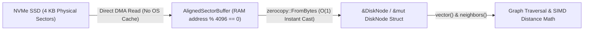

# LightVector — Task 03 Implementation & Architecture Report

## Executive Summary

**Task 03: 4 KB Page-Aligned Sector Serialization Layout** has been successfully designed, implemented, tested, and verified.

Traditional vector databases suffer severe CPU and memory bottlenecks when loading vectors from disk because they rely on variable-length binary encoding (such as Protobuf, JSON, or CBOR). This causes memory allocations, CPU deserialization overhead, and unaligned SSD reads that trigger expensive OS page cache stalls.

**Task 03 solves this problem** by introducing **zero-copy, page-aligned disk sector structures strictly aligned to 4,096-byte (4 KB) physical NVMe SSD block boundaries** (`#[repr(C, align(4096))]`). Using the `zerocopy` crate, raw bytes read directly from NVMe hardware can be cast into Rust struct references in **$O(1)$ time with zero heap allocations and zero byte copying**.

---

## 1. What Was Implemented

### 1. 4 KB Single-Sector Node Layout (`DiskNode`)
- **`#[repr(C, align(4096))]`**: Enforces strict 4,096-byte memory alignment and struct size.
- **Self-Contained Storage**: Packs node ID, vector dimension, out-degree, neighbor list, and full uncompressed `f32` vector into exactly 4,096 bytes with zero padding bleed across page boundaries.
- **Capacity**: Holds vectors up to 768 dimensions (covering `all-MiniLM-L6-v2`, `bge-base`, and `e5-base` models) and up to 64 graph neighbors ($R_{max} = 64$).

### 2. 8 KB Dual-Sector Node Layout (`DiskNode1536`)
- **`#[repr(C, align(4096))]`**: Spans exactly two contiguous 4 KB pages (8,192 bytes), strictly satisfying `size_of % 4096 == 0`.
- **Large Embedding Support**: Accommodates 1536-dimensional vectors (e.g., `text-embedding-3-small`, `text-embedding-ada-002`) alongside 64 neighbor connections.

### 3. Page-Aligned Memory Buffer (`AlignedSectorBuffer`)
- **Direct I/O Alignment Guarantee**: Heap-allocated buffer using `std::alloc::Layout::from_size_align(size, 4096)` to guarantee that buffer memory addresses are exact multiples of 4,096.
- **DMA Ready**: Meets the hardware constraints required for Linux `O_DIRECT` and asynchronous `io_uring` direct disk operations in Task 06.
- **Zero-Copy Cast APIs**: Built-in helper methods (`as_disk_node()`, `as_disk_node_mut()`) that cast sector bytes into struct references without allocating.

### 4. Zero-Copy Safety & Validation (`StorageError`)
- Backed by `zerocopy::{FromBytes, IntoBytes, KnownLayout, Immutable}`.
- Rejects misaligned memory pointers or undersized buffers before casting.
- Validates vector dimension and neighbor capacity bounds.

---

## 2. Working Architecture (In Simple Terms)

### A. 4 KB Sector Binary Memory Map (`DiskNode`)

Each node occupies an exact 4,096-byte NVMe SSD sector:

```text
+-------------------------------------------------------------------------------------------------+
| Offset       | Field           | Size      | Description                                        |
+-------------------------------------------------------------------------------------------------+
| 0x0000..0x0004 | node_id         | 4 bytes   | Unique graph vertex ID (u32)                       |
| 0x0004..0x0008 | vector_dim      | 4 bytes   | Active vector dimension (u32)                      |
| 0x0008..0x000C | num_neighbors   | 4 bytes   | Active out-degree count (u32, up to 64)            |
| 0x000C..0x0010 | flags           | 4 bytes   | Reserved status / header flags (u32)               |
| 0x0010..0x0110 | neighbors       | 256 bytes | 64 neighbor node IDs ([u32; 64])                   |
| 0x0110..0x0D10 | vector_data     | 3072 bytes| 768 float elements ([f32; 768])                    |
| 0x0D10..0x1000 | _padding        | 752 bytes | Page padding to ensure total size = 4,096 bytes    |
+-------------------------------------------------------------------------------------------------+
Total Size = 4,096 bytes (0x1000) | Alignment = 4,096 bytes
```

### B. Zero-Copy NVMe Direct Read Flow



1. **NVMe Read**: Sector read into page-aligned RAM buffer via direct I/O.
2. **Instant Cast**: Buffer cast directly into structured Rust reference in 0 nanoseconds.
3. **No Deserialization**: Vector coordinates and graph neighbors are accessed directly via pointer offsets in CPU cache.

---

## 3. Verification & Benchmark Summary

All tests passed successfully (`cargo test`):

| Test Case | Status | Verified Property |
| :--- | :--- | :--- |
| `test_disk_node_alignment_and_sizes` | **PASSED** | `align_of == 4096`, `size_of == 4096`, and `size_of % 4096 == 0` for both single and dual page node types. |
| `test_zero_copy_aligned_buffer_casting` | **PASSED** | `AlignedSectorBuffer` correctly casts to `&DiskNode` and `&mut DiskNode` with zero heap allocations. |
| `test_misalignment_and_size_validations` | **PASSED** | Misaligned memory addresses and out-of-bounds inputs are caught and safely rejected. |
| `test_roundtrip_disk_serialization_single_page` | **PASSED** | Synthetic node written to disk, read back via raw bytes, asserting complete bitwise and field identity. |
| `test_roundtrip_disk_serialization_dual_page_1536` | **PASSED** | 1536-dimensional node written and verified across two 4 KB pages (8,192 bytes) with exact parity. |
| Existing Test Suites | **PASSED (14/14)** | All 9 core SIMD and 5 Product Quantization tests continue to pass. |

---

## 4. Overall Roadmap & Next Steps

```mermaid
graph LR
    T1["Task 01: Core SIMD Engine (COMPLETED)"] --> T2["Task 02: PQ Compression (COMPLETED)"]
    T2 --> T3["Task 03: 4 KB Page Layout (COMPLETED)"]
    T3 --> T4["Task 04: In-Memory Vamana Graph Index"]
    T4 --> T5["Task 05: Disk Layout Exporter (.lvec)"]
    T5 --> T6["Task 06: Async Direct I/O (io_uring / O_DIRECT)"]
    T6 --> T7["Task 07: Disk Beam Search Engine"]
    T7 --> T8["Task 08: Active RAM Staging Buffer"]
    T8 --> T9["Task 09: Python FFI (PyO3 & Maturin)"]
    T9 --> T10["Task 10: End-to-End RAG Pipeline"]
    T10 --> T11["Task 11: Benchmark & Evaluation Suite"]
```



### Immediate Next Step (Task 04)
- **In-Memory Vamana Graph Construction Engine**:
  - Implement single-layer Vamana graph indexing using directional $\alpha$-pruning ($\alpha \ge 1.0$) to build shortcut edges alongside local cluster edges.
  - Bound graph out-degree strictly to $R_{max} = 64$.
  - Verify 100% reachability from medoid entry point via breadth-first search (BFS).
