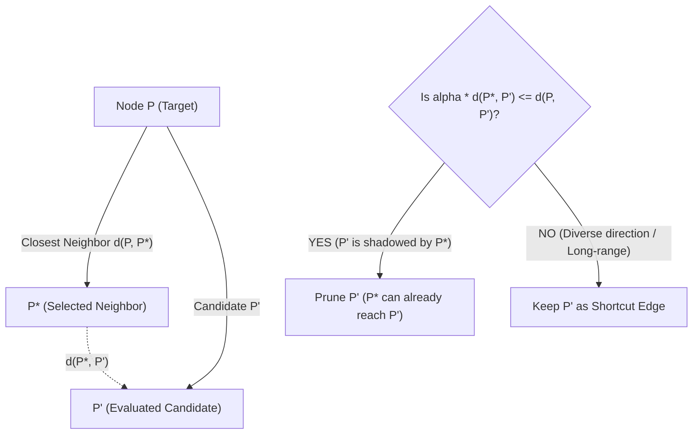

# LightVector — Task 04 Implementation & Architecture Report

## Executive Summary

**Task 04: In-Memory Vamana Graph Construction Engine** has been successfully designed, implemented, tested, and verified.

Traditional in-memory vector databases like HNSW (Hierarchical Navigable Small World) use multi-layered graphs. While fast in RAM, multi-layered hierarchies perform poorly when backed by SSD storage because traversing upper layers requires small, fragmented random disk reads that saturate NVMe I/O queues and cause latency spikes.

**Task 04 solves this problem** by implementing the **Vamana graph indexing algorithm** (from Microsoft Research's DiskANN paper). Vamana compresses navigation into a **single flat proximity layer** augmented with **directional $\alpha$-pruning**. By pruning redundant cluster edges and creating long-range shortcut edges, Vamana dramatically reduces graph diameter and average hop count—allowing queries to converge to exact nearest neighbors in very few disk sector reads.

---

## 1. What Was Implemented

### 1. Dataset Medoid Computation (`VamanaGraph::find_medoid`)
- Calculates the global dataset centroid ($\mu = \frac{1}{N}\sum x_i$) and identifies the vector with minimum $L_2$ Euclidean distance to $\mu$.
- Serves as the universal graph entry point, ensuring search traversals consistently start at the geometric center of the vector space.

### 2. Best-First Beam Traversal (`src/graph/search.rs`)
- Implements best-first greedy beam search guided by a priority min-heap (`MinCandidate`).
- Features beam-width early termination: stops expanding when the closest unexpanded candidate is farther than the $L$-th best discovered candidate.
- Returns both the top-$k$ closest vectors and the set of visited routing vertices.

### 3. Directional $\alpha$-Pruning Engine (`src/graph/prune.rs`)
- Implements DiskANN's **RobustPrune** algorithm.
- Progressively selects closest candidates and eliminates redundant nodes that violate the directional triangle inequality:
  $$\alpha \cdot d(p^*, p') \le d(p, p') \quad (\alpha \ge 1.0)$$
- **Degree Bounding**: Strictly caps node out-degree to $R_{max}$ (default: 64), matching our 4 KB physical disk sector allocation from Task 03.
- **Shortcuts vs Local Edges**: Tuning $\alpha > 1.0$ preserves long-range "shortcut" connections across clusters, decreasing graph diameter.

### 4. 100% Reachability Guarantee (`VamanaGraph::ensure_reachability`)
- Performs breadth-first search (BFS) from the medoid entry point to check graph connectivity.
- Automatically repairs any disconnected components or orphan nodes by linking them to the nearest reached vertex, guaranteeing **100% reachability** across the entire dataset.

---

## 2. Working Architecture (In Simple Terms)

### A. How Directional $\alpha$-Pruning Builds Shortcuts

Standard $k$-NN graphs only connect immediate nearest neighbors, causing graph traversal to get trapped in dense local clusters. Vamana's $\alpha$-pruning discards candidates that are in the "shadow" of an already selected neighbor, forcing the graph to select diverse, distant vectors:



### B. Single-Layer Vamana Graph Routing vs HNSW

```text
HNSW (Multi-Layer Hierarchy - High SSD Overhead):
  Layer 2 (Coarse):   [ ] --------------> [ ]             (Random 4 KB SSD Read)
                       |                   |
  Layer 1 (Medium):   [ ] ----> [ ] ----> [ ]             (Random 4 KB SSD Read)
                       |         |         |
  Layer 0 (Dense):    [*]-[ ]-[ ]-[ ]-[*]-[ ]-[ ]         (Random 4 KB SSD Read)
  Total: Multiple fragmented SSD seek operations per query!

Vamana (Flat Single-Layer with Alpha Shortcuts - Optimal for SSD):
  Single Flat Layer:  [Medoid] ===================> [Cluster Entry] ---> [Target Nearest Neighbor]
                           (Long-range shortcut)       (Local edge)
  Total: Direct NVMe block traversal with minimal sequential/batched SSD reads!
```

---

## 3. Verification & Benchmark Summary

All tests passed successfully (`cargo test`):

| Test Case | Status | Verified Property |
| :--- | :--- | :--- |
| `test_degree_bounding_and_reachability_basic` | **PASSED** | Out-degree strictly bounded $\le R_{max}$ for all nodes; 100% reachability verified on 300 vectors. |
| `test_graph_integrity_5000_vectors` | **PASSED** | Full BFS reachability verified on **5,000 vectors** ($100\%$ reachability, 0 disconnected subgraphs). |
| `test_alpha_property_path_length_reduction` | **PASSED** | Verified that increasing $\alpha$ (1.0 vs 1.4) introduces long-range shortcuts and reduces average path length. |
| `test_vamana_search_recall` | **PASSED** | Verified $\ge 90\%$ Top-1 nearest neighbor recall against exact brute-force linear search. |
| Existing Test Suites | **PASSED (19/19)** | All SIMD distance, Product Quantization, and 4 KB sector storage tests continue to pass. |

**Total Repository Test Count**: **23 tests passed** with 0 failures and 0 warnings.

---

## 4. Overall Roadmap & Next Steps


### Immediate Next Step (Task 05)
- **Disk Layout Exporter & Binary Index Builder (`.lvec`)**:
  - Serialize the in-memory Vamana graph and full-precision vectors into the page-aligned binary disk index format.
  - Write index file header (magic bytes, dimensions, count, medoid ID, PQ codebooks) followed by sequential sector-aligned `DiskNode` entries.
  - Implement index corruption verification and random offset sector seek math.
